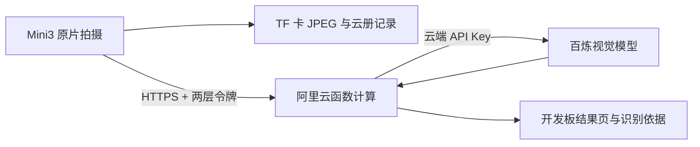

# ListenAI Mini3 Cloud Recognition

聆思 Mini3 的单键相机与识云验证项目。界面参考第六代 iPod nano，使用浅蓝色选中框；应用顺序为 **时钟 → 识云 → 相机 → 相册 → 设置**。

本仓库保存 2026-10-27 测试版的源码覆盖文件、阿里云百炼中转、公开应用固件和功能记录。原始 SDK 从上游取得；本仓库通过 `overlay/` 还原相关修改。

## 已实现

- 240×240 非触控屏，单击下一项、双击确认、约 0.9～3 秒松手返回、长按满 3 秒关机。
- 时钟：段码 / Rubik / 点阵；联网后自动校时，UTC+8。
- 相机：240×180 取景，原图 / 色块 / 单色 / CRT 特效；JPEG 保存至 TF 卡。
- 相册与云册：查看卡上图片；识云记录关联照片和 JSON。
- 识云：原片拍摄 → HTTPS 上传 → 阿里云函数计算 → 百炼视觉模型；显示云型、模型自评高/中/低和判别依据。
- 结果页单击切换详情，未知结果显示“暂无法识别”。模型自评不代表经过统计校准的准确率。
- 热点配网：开发板先扫描周围的wifi，随后再开启自身热点。手机连接临时 WPA2 热点，在 `http://192.168.4.1` 选择 Wi-Fi 并提交密码。
- 八类设置、设备诊断及官方应用 OTA 防覆盖设置。



## 当前验证程度

原机固件已经实测拍照、上传并显示模型结果；手机屏幕翻拍、不清晰、对比度不够等情况有概率被模型判为 unknown / low。开发板严格 TLS 校验已验证：正确域名通过、错误域名会被拒绝。

室外真实天空效果、拔掉电脑后重启并再次识别、新结果在云册中重新打开等已经进行了相关测试和验证。

**预留扩展项：** 目前识云功能中的位置与天气信息可用于未来结合拍摄时间、城市位置和气象背景，辅助云型判别、提升云类型识别的准确性。本版主要以图像为主要识别依据，相关的处理由api、云端模型完成。辅助信息带来的准确性提升需自行配置高德、openmap相关的接口后验证。

## 目录

| 目录 / 文件 | 用途 |
| --- | --- |
| `overlay/` | 相对原 SDK 根目录的修改和新增文件；包含 UI、相机、配网、时间及 TLS 代码。 |
| `relay/` | 当前百炼中转代码、测试和设备配对脚本；不含任何实际 Key 或令牌。 |
| `firmware/` | 清空原工程默认云产品标识和密钥后，单独重新编译的公开 CP 应用固件及校验信息。 |
| `docs/` | 功能概要、验证状态、部署说明。 |
| `legacy/cloud-worker/` | 早期 Cloudflare 路线的方案，保留参考。 |
| `upstream.json` | 原 SDK 地址、基底提交和覆盖文件清单。 |
| `scripts/apply-overlay.ps1` | 将覆盖文件应用到干净、版本匹配的 SDK 工作目录。 |

## 构建

取得 `upstream.json` 指定的 SDK 基底 `23fca91e13dbd0f2c81eb2f69a6b337953021637`，准备其工具链和依赖。在本仓库执行：

```powershell
.\scripts\apply-overlay.ps1 -SdkRoot 'D:\path\to\arcs-mini-sdk'
```

然后在 SDK 根目录执行：

```powershell
.\build.ps1 -S .\apps\arcs-mini -DBOARD=arcs_mini3
```

该路径依赖上游 SDK 及其授权和依赖文件。本仓库不是 SDK 的完整镜像。公开覆盖配置已清空原工程的默认云凭据；不要将自己的凭据提交回 Git。

## 固件与部署

公开 BIN 对应 **CP app 分区**，地址为匹配 Mini3 分区表中的 `0x600000`；它不是完整救砖镜像。应在匹配的 Mini3 系统和资源分区上使用，刷写前核对板型及 SHA-256。公开构建未刷入原开发板，原机仍保留已验证版本；公开构建与原机版本的差异见 `firmware/README.md`。

识云须自行部署 `relay/index.js`、配置百炼 Key、设置 Bearer 网关及设备令牌，并将 `nano_cloud_transport.c` 和 `nano_tls_probe.c` 内的主机名改为自己的服务。部署步骤见 [云端与设备配置](docs/云端与设备配置.md)。

开发板识云由 Wi-Fi 直连云端，电脑仅用于前期/烧录阶段的测试、开发和配对；独立使用时建议插电或确认充满电再使用，并提前配置好wifi以便正确校时和为证书提供时间参考。

## 凭据、费用与使用范围

本项目为个人硬件验证。`fcapp.run` 相关的阿里云默认地址只用于测试。百炼和函数计算分别计量；百炼额度用完即停不等于函数计算费用上限。设备访问令牌位于设备 KV，可被调试接口读取；百炼 API Key 仅放云函数环境变量。

另：上游代码的版权与许可仍归其原权利人；本仓库未为全部代码添加统一开源许可，详见 [来源与许可](NOTICE.md)。
